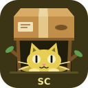
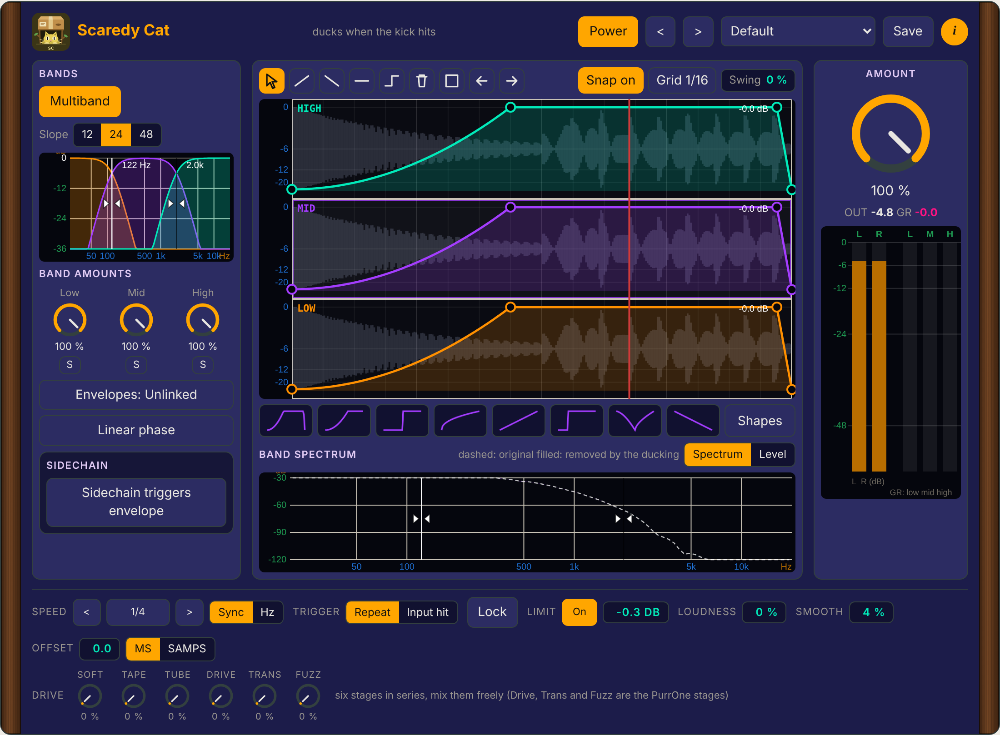

# Scaredy Cat 🐈

A free, open source volume shaper (VST3 and standalone) for kick pumps, trance gates and chops, from the Studio 87 cat plugin suite. It splits the sound into three bands and gives each band its own drawn volume curve, tempo synced or triggered by hits. No sidechain needed (but it can use one).

 Screenshot of the plugin page in docs/mockups.

## What it does
- Three bands (crossovers at 120 Hz and 2.4 kHz by default, 12/24/48 dB per octave or linear phase), each with its own envelope you draw.
- Envelope editor: drag points, double click to add, bend segments, ramp/hold/step tools, shape presets, grid, snap, swing, lock.
- Speed in note lengths (sync) or Hz, offset in ms or samples, Repeat or Input hit trigger, optional sidechain trigger.
- Six mixable drive stages (Tube, Tape, Soft, PurrOne Drive, Transistor, Fuzz, oversampled), Loudness (opto leveller and hidden soft clipper, dry/wet), lookahead limiter, per-band gain reduction meters, band spectrum and level views that show what the ducking removes.
- Shape library with thumbnails (your own shapes too), click-free default shape, resizable from every edge and corner.
- AMOUNT 0 % is an exact bypass (bit for bit), 100 % is the full depth you drew. Exact latency is reported to the host.
- No telemetry, no network, no data collected.

## Status
First build: the code compiles in CI and the DSP core has automated tests (`sh tests/run.sh`), but nothing has been listened to or run in a DAW yet.

  

☕ Free and open source, made by one person. If it helps your music, a coffee on [Ko-fi](https://ko-fi.com/studio87) keeps it coming. 💜

## Docs
- [Manual (PDF)](docs/ScaredyCat-manual.pdf)
- [Interactive mockup](docs/README.md)
- [Roadmap](ROADMAP.md)

## Build
`cmake -S . -B build -DCMAKE_BUILD_TYPE=Release && cmake --build build` (JUCE and cat-ui are fetched by CMake). The DSP lives in `src/core` (no JUCE) and is tested with `sh tests/run.sh`.

## License
AGPL-3.0-or-later, see [LICENSE](LICENSE).

Not affiliated with or endorsed by any hardware maker named here. All trademarks belong to their owners.
